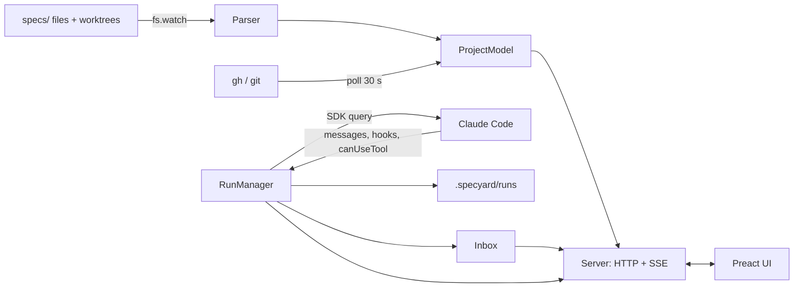
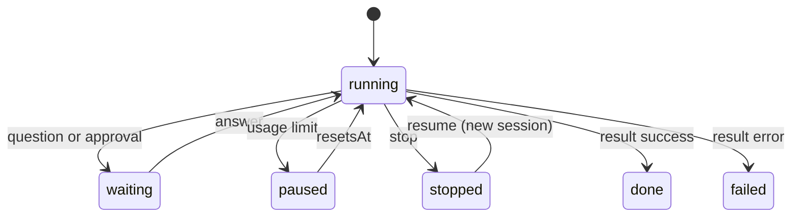

# Specyard — Design

## Overview
- Local web UI and CLI that shows a `specs/<project>/` tree as a graph, list, inbox and evidence pages, and runs the workflow skills on it.
- One Node process: it watches the spec files, derives all state from files, git and PRs, runs skills through the Claude Agent SDK, and pushes updates to a Preact UI over Server-Sent Events.



## Components
All in one npm package `specyard`, TypeScript, Node >= 22, ESM. `src/` for the server and CLI, `ui/` for the UI.
- `cli.ts`: commands `specyard [--path <dir>]`, `specyard runs`, `--version`. Finds the repo root (nearest folder with `specs/`, not above the git root), runs the start checks (FR2 to FR7), then starts `Server`.
- `checks.ts`: Claude Code present and logged in (`claude auth status --json`, field `loggedIn`; fix command `claude auth login`); each workflow skill present (`~/.claude/skills/<name>/SKILL.md` exists; no versions); project found.
- `parser/`: pure functions, file text to typed model. One module per file kind:
  - `milestones.ts`: `## M<n>. <Name>`, `- Needs: M1, M2.`, feature lines `F<k>. <name>: <line>. Docs: <list>. Needs: <ids>. Status: <s>.`
  - `tasks.ts`: parents `## <n>. <title> [parallel|serial(, needs <ids>)]`, checkboxes `- [ ]` / `- [x]` with ids, `Status:` line.
  - `progress.ts`: the progress.md table (task, status, attempts, last failure), changed tests, rejected findings. Fix tasks `X<n>`, and old `F<n>` read as `X<n>` (FR67).
  - `header.ts`: the `Status:` line of tasks.md (`approved <hash>` is written by Specyard; no line means in review).
  - Parse errors are values (`{ ok: false, line, expected }`), never throws (FR20).
- `model.ts`: builds `ProjectModel` from parsed files, git, PRs and runs: stages, dependency graph, critical path, can-start-now. Pure, so it is fully testable.
- `watch.ts`: `fs.watch(projectDir, { recursive: true })` plus each active worktree's feature folder. 150 ms debounce, then full re-parse and model rebuild.
- `git.ts`: default branch, worktree add and remove, ancestry check. Calls `git` with `execFile`.
- `prs.ts`: every 30 s `gh pr list --state all --json number,headRefName,state,mergedAt,url,statusCheckRollup`. Without `gh` or a GitHub remote: `git fetch` every 30 s and the ancestry check. Merge: `gh pr merge <n>` with the repo default method.
- `runs/RunManager.ts`: starts, stops, resumes and pauses runs. One SDK `query()` per run with streaming input. Keeps the in-memory state of running runs.
- `runs/events.ts`: turns SDK messages and progress lines into `RunEvent`s. Progress line grammar: `^\[(read|build [\w.]+|feature r\d+|ship|stop)\] (.*)$`.
- `inbox.ts`: open items. Built from run waits (text questions, tool approvals), BLOCKED and stop events, and PRs with green evidence.
- `notify.ts`: `osascript -e 'display notification ...'` on macOS, `notify-send` on Linux when found, else nothing.
- `server.ts`: `node:http` on `127.0.0.1`, port 4317 or the next free one. Serves `ui/dist` and a JSON API, plus one SSE stream.
- `ui/`: Preact + Vite, built to `ui/dist` at publish. Markdown with `marked`, diffs with `diff` (jsdiff). Graph layout by hand: one lane per milestone, rows by dependency depth, SVG edges. Blueprint light style from `mocks/styles.css` (NFR10).

## Data Model
In files (source of truth):
- Generated file header, right under the title:
  ```
  Status: approved 9c03de51aa48
  ```
  `Status:` is only in tasks.md: `draft` or `approved <hash>`. The approval hash covers tasks.md without these two lines (FR26).
- Feature stage inputs: milestones.md feature line (`Docs`, `Needs`, `Status`), feature files, progress.md, run state, PR state.

In `specs/<project>/.specyard/` (holds `.gitignore` with `*`, FR60):
- `settings.json`: `{ bypassPermissionsAllowed: false }` and UI choices.
- `runs/<runId>/run.json`: `{ id, kind: 'implement'|'to-design'|'to-tasks'|'to-milestones'|'to-brd'|'expert-review', target: 'M2·F1', sessionId, worktree?, state: 'running'|'waiting'|'paused'|'stopped'|'done'|'failed', pausedUntil?, startedAt, endedAt? }`
- `runs/<runId>/events.jsonl`: one `RunEvent` per line.
- `runs/<runId>/before/`: copies of the files the run may rewrite (FR24).

In memory: `ProjectModel`, running `Query` handles, open waits (`Map<waitId, resolve>`).

Types:
- `Stage = 'needs-design'|'needs-tasks'|'tasks-in-review'|'waits-on-deps'|'ready'|'running'|'needs-you'|'paused'|'stopped'|'pr-open'|'done'`
- `RunEvent = { t: number, kind: 'phase'|'progress'|'subagent-start'|'subagent-stop'|'question'|'approval'|'answer'|'verdict'|'rate-limit'|'end', data: object }`

## Interfaces
HTTP API on 127.0.0.1. Every `/api/*` request needs `?t=<token>` or the `X-Specyard-Token` header, and the `Origin`, when sent, must match the server (NFR7). Bad token or origin: 403. Static UI files hold no project data and need no token.
- `GET /api/project` → `ProjectModel`. Picker list when there is more than one project.
- `GET /api/events` (SSE) → `project` (full model), `run` (RunEvent with runId), `inbox` (full list).
- `GET /api/file?path=` → file text, for the spec tabs.
- `GET /api/runs/:id` → run.json + events.
- `POST /api/runs` `{ kind, target, comment?, bypassPermissions? }` → `{ runId }`. 409 when Implement gates fail (FR27), with reasons.
- `POST /api/runs/:id/stop` → 202. `POST /api/runs/:id/resume` → `{ runId }`.
- `POST /api/inbox/:waitId` `{ answers?: Record<question, string>, decision?: 'approve'|'skip', reply?: string }` → 204. 409 when a batch is not fully answered (FR42).
- `POST /api/features/:id/approve` → writes the Status line.
- `POST /api/context` (multipart) → copies into `context/`.
- `POST /api/prs/:n/merge` → `gh pr merge`.

## Flow
Implement:
- 1. UI posts `POST /api/runs {kind: implement, target}`. Server checks gates from `ProjectModel` (FR27).
- 2. `git worktree add ../<repo>-m<n>-f<k> -b <feature-kebab-name> <default-branch>`.
- 3. `query({ prompt: stream, options: { cwd: worktree, settingSources: ['user','project','local'], canUseTool, hooks: { SubagentStart, SubagentStop }, abortController } })`. First message: `/implement-feature <tasks.md path>` plus the context file paths (FR10).
- 4. Each SDK message becomes `RunEvent`s, appended to events.jsonl and pushed over SSE (NFR2).
- 5. Questions: the skills ask in text (`Q:` / `Recommend:` / `Why:` blocks; several when Specyard's prompt asks for batched questions). A turn that ends with such blocks becomes one inbox item; the answers go back as the next user message through `streamInput`, and the run continues. A tool call that would prompt in the CLI arrives through `canUseTool` and becomes an approval item (FR37).
- 6. `rate_limit_event` with `status: 'rejected'`: state `paused`, `pausedUntil = resetsAt`. A timer at `resetsAt` starts `query({ resume: sessionId })` with "Continue." (FR39).
- 7. Stop: send "Stop now. Clean up what you started, update progress.md, then end." Then `interrupt()` and abort after 120 s (FR33).
- 8. PR merged (from `prs.ts`): feature `done`, `git worktree remove` without `--force`. Dependents re-checked, and newly ready ones notify (FR30).




## Key Decisions
- D1. One process, Node `http` + SSE, no WebSocket. Alternative: `ws`. Why: one less dependency, and the UI only needs server-to-browser pushes.
- D2. Full re-parse on every file change. Alternative: incremental updates. Why: 2,000 tasks parse in milliseconds, and full rebuilds cannot drift from the files (NFR8).
- D3. Run events from the SDK stream plus the progress lines the skills already print. Alternative: an event tool or an event file. Why: no extra tool calls or permission prompts, and the CLI output stays the same.
- D4. Questions as the skills already ask them (text blocks), not a custom tool. Alternative: change the skills to call a question tool. Why: the skills stay as they are and work the same in the plain CLI (FR63).
- D5. Worktree as a sibling folder `<repo>-m<n>-f<k>`. Alternative: inside `.specyard/`. Why: matches the current layout, and tools inside the repo do not index a second copy.
- D6. milestones.md `Status:` is read only and a merged PR outranks it. Alternative: Specyard writes Status on merge. Why: FR58 limits what Specyard writes, and the PR is the real signal.
- D7. Stop by message, then interrupt after 120 s. Alternative: abort at once. Why: the skill's own cleanup stops servers and sandboxes.
- D8. Usage-limit resume reuses the session, Stop then Resume starts a new one. Why: a pause keeps useful context, and a stopped run has progress.md as its memory.
- D9. Graph layout by hand. Alternative: dagre or elkjs. Why: lanes by milestone and rows by depth cover the mocks with no layout library.

## Skills
- Specyard does not change, bundle, version or install the workflow skills (FR12, FR61 to FR67 removed). It invokes them as a user does (FR63).
- One standalone change in `/to-brd`, `/to-design`, `/to-tasks` (`/to-milestones` has no question step): one question at a time by default; all independent questions of a step together when the user asks for batched questions (FR62). Specyard's prompt asks for batched questions.

## Open Questions
- OQ1. Is the npm name `specyard` free at publish time? Owner: Lead.
- OQ2. Without `gh`, squash merges do not show as merged (no ancestry). Accepted limit: use `gh`.
